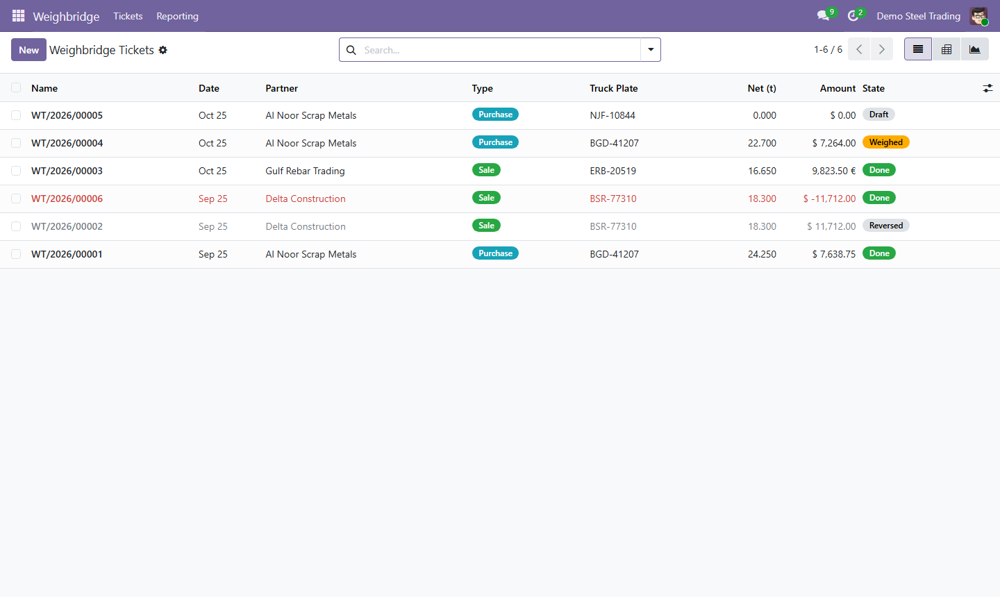
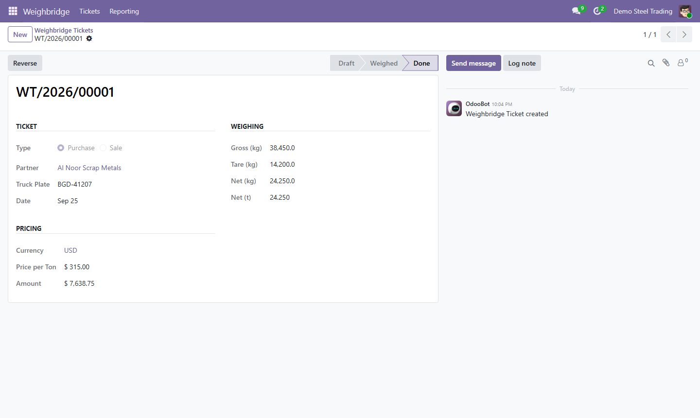
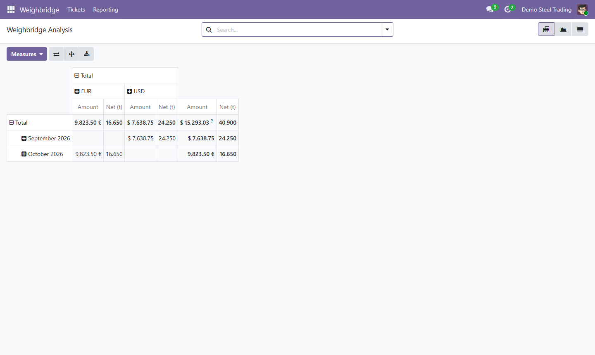
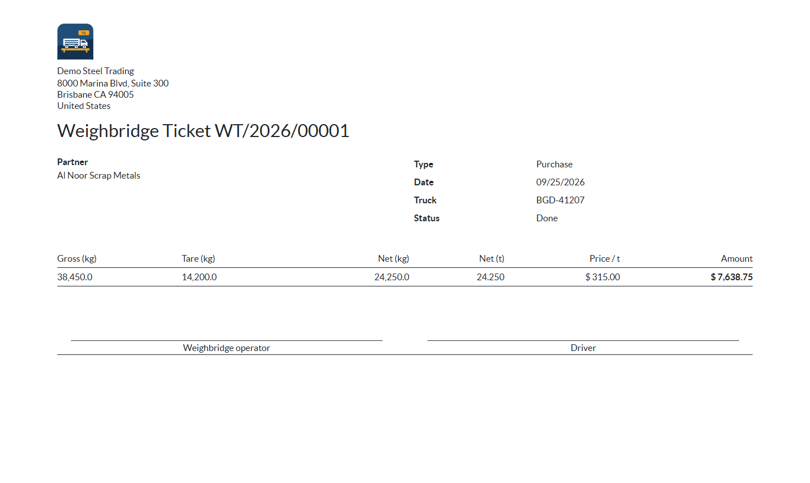

# Steel Weighbridge for Odoo 19

[](https://github.com/modar-m-dwery/odoo-steel-weighbridge/actions/workflows/ci.yml)


Weighbridge tickets for a steel trader: weigh trucks loaded and empty, price the
net weight by the tonne in any currency, cancel by reversal, and report per currency.

I built this module to show how I write production Odoo code: invariants are
enforced by PostgreSQL, access rules live in record rules, and every rule has a
test. It is a clean-room portfolio project inspired by weighbridge and steel
trading work I did for clients; it contains no client code or data.

| Tickets | Ticket form |
|---|---|
|  |  |

| Analysis per currency | Printed ticket |
|---|---|
|  |  |

## Features

- **Weighing:** gross and tare in kg; net weight in kg and tonnes. Tonnes are
  editable too, and write back the gross weight.
- **Pricing:** price per tonne and amount in the ticket currency (USD, EUR, IQD...).
- **Workflow:** draft → weighed → done, with *Reset to Draft* for open weighings.
- **Cancellation by reversal:** a completed ticket is never deleted; reversing
  creates an opposite ticket and keeps the original for the audit trail.
- **Security:** sales clerks see sale tickets, purchase clerks see purchase
  tickets, managers see both; companies only see their own tickets.
- **Reporting:** pivot and graph views with one column per currency, a monthly
  statement API that never adds currencies together, and a printable ticket.
- **Daily summary:** a scheduled job stores each company's completed tonnage once per day.

## Design decisions

| Problem | Solution | Where |
|---|---|---|
| Two weighings open for the same truck double-count a load, and a Python check cannot stop two concurrent requests | Partial unique index `(truck_plate, company_id) WHERE state = 'weighed'` | `models/weigh_ticket.py`, [ADR 0003](docs/adr/0003-database-guards.md) |
| Deleting a completed ticket breaks the audit trail and the numbering | `action_reverse()` creates an opposite ticket; only drafts can be deleted (`@api.ondelete`) | [ADR 0001](docs/adr/0001-reverse-instead-of-delete.md) |
| Filtering in `search()` leaks through other read paths (counts, groupings, exports) | Group record rules (combined with OR) plus a global multi-company rule | `security/security.xml`, [ADR 0002](docs/adr/0002-record-rules-for-isolation.md) |
| Monthly totals computed in a Python loop are slow and easy to get wrong across currencies | One `_read_group` per currency, done by the database | `models/statement.py` |
| A bulk action fails completely because of one bad ticket | A savepoint per ticket; failures are logged and counted | `action_bulk_done()` |
| A scheduled job that runs twice creates duplicate rows | Check before insert, backed by `UNIQUE(date, company_id)` | `models/daily_summary.py` |

## Tests

15 tests run on every push with GitHub Actions on PostgreSQL 16 and Odoo 19.0:

- **workflow:** net weight and tonnage, tonnes → gross inverse, batch numbering,
  invalid weights rejected, reversal keeps the original and nets to zero, a
  ticket is reversed only once, only drafts can be deleted, bulk completion
  isolates failures
- **concurrency guard:** a second open weighing for the same truck raises a unique violation
- **security:** clerk vs manager visibility, company isolation
- **reporting:** per-currency monthly totals, reversed pairs cancel out,
  idempotent daily summary, the ticket report renders

Run them locally:

```bash
odoo-bin -d test_db -i steel_weighbridge \
  --addons-path=/path/to/odoo/addons,/path/to/odoo-steel-weighbridge \
  --test-enable --test-tags /steel_weighbridge --stop-after-init
```

Expected: `0 failed, 0 error(s) of 15 tests`.

## Installation

1. Clone this repository next to your Odoo 19 source and add its folder to `--addons-path`.
2. Update the apps list and install **Steel Weighbridge** (depends only on `mail`).
3. Give users one of the *Weighbridge* access levels: Sales Clerk, Purchase Clerk or Manager.

Install with `--with-demo` to get sample partners and tickets.

## Project structure

```
odoo-steel-weighbridge/
├── steel_weighbridge/
│   ├── models/      weigh_ticket.py · daily_summary.py · statement.py
│   ├── security/    security.xml · ir.model.access.csv
│   ├── views/       list, form, search, pivot, graph, menus
│   ├── report/      printable weighbridge ticket (QWeb)
│   ├── data/        ticket sequence · daily summary cron
│   ├── demo/        sample partners and tickets
│   └── tests/       15 tests
├── docs/adr/        architecture decision records
└── .github/workflows/ci.yml
```

## بالعربية

موديول أودو 19 لتذاكر القبّان في تجارة الحديد: وزن الشاحنة محمّلة وفارغة، والصافي بالكيلوغرام والطن،
والتسعير بالطن بأي عملة، والإلغاء بقيد عكسي بدل الحذف، وتقارير منفصلة لكل عملة.
الثوابت المهمة مفروضة في PostgreSQL (فهرس فريد جزئي يمنع وزنتين مفتوحتين للشاحنة نفسها)،
والصلاحيات بقواعد السجلات بين المبيعات والمشتريات والشركات، و15 اختباراً تعمل تلقائياً مع كل رفع للكود.

## Author

**Modar Dwery**, Odoo Developer (Odoo 16 / 18 / 19) ·
[LinkedIn](https://www.linkedin.com/in/modar-dwery) · modar.m.dwery@gmail.com

Licensed under [LGPL-3](LICENSE).
